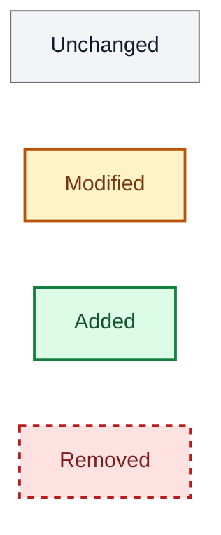
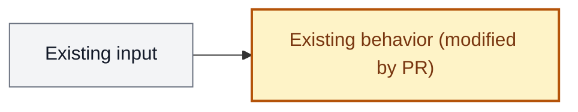

# Code Review

One orchestrated review that favors **signal over volume**. The goal is a short list of
findings a human reviewer will trust — not an exhaustive dump. A review that flags thirty
things trains the author to ignore all thirty.

**Default base branch:** `main`. If a base-branch argument is given, use it instead.
For a PR URL, resolve its actual base and head with `gh`; review that diff rather than
assuming the PR targets `main`. Record the reviewed revisions so the walkthrough and
comment anchors describe the same version.

## Operating principles

1. **Signal first.** A missed nit costs nothing; a false positive costs trust. When in
   doubt about whether something is a real problem, drop it or mark it low confidence.
2. **Evidence or silence.** Every Critical/Major finding cites `file:line`, quotes the
   offending code, and gives a concrete fix. No "consider reviewing…".
3. **Route, don't blanket.** Review only the concerns the diff actually touches.
4. **Fresh eyes.** Reviewer sub-agents get clean context (see the `diff-reviewer` agent), so
   they can catch mistakes the author/orchestrator already rationalized.
5. **"Nothing blocks" is a valid result.** If a concern is clean, it returns
   `no_findings`. Do not manufacture concerns to look thorough.

## Step 1 — Gather the diff

```bash
git diff <base-branch>...HEAD          # committed changes vs base
git diff                               # unstaged changes
git diff --name-only <base-branch>...HEAD
git diff --name-only
```

Combine both diffs. Detect the primary language(s) from the changed file extensions —
this selects the language notes in Step 3.

## Step 2 — Classify and route

Classify the change shape, then pick the concerns to run. State your routing decision
(activated concerns + one-line reason each) before dispatching.

| Change shape | Typical concerns |
|--------------|------------------|
| `docs-only` | Comments only (usually skip the rest) |
| `tests-only` | Tests, Comments |
| `config/infra` | Correctness (of the config), Security if it touches auth/permissions/CI |
| `product-runtime` | All applicable concerns |
| `mixed` | Route each area independently |

### Always consider
- **Correctness** — any new/changed logic, error handling, concurrency, I/O, security-sensitive code.
- **Tests** — any executable change (including CI/build scripts).

### Conditional
- **Design** — new public APIs, new abstractions, refactors spanning multiple files.
- **Comments** — any added/modified comments or missing "why" on non-obvious code.
- **Security** — auth, tokens, secrets, input parsing, URL/path construction, SQL, dependency manifests. Never suppress for these.

**When genuinely uncertain, include the concern.** Omit only when the area is clearly
absent from the diff.

## Step 3 — Dispatch reviewer sub-agents

Run the activated concerns through the **`diff-reviewer` sub-agent** (forked/clean context,
tuned to refute-by-default). The `diff-reviewer` agent is defined once and rendered per harness
(pi: `~/.pi/agent/agents/diff-reviewer.md`; Claude Code: `~/.claude/agents/diff-reviewer.md`).

**Sub-agent dispatch is mandatory — never self-review.** The entire value of this skill is
fresh eyes: a reviewer that has not seen your reasoning can independently disagree. You,
the orchestrator, have already rationalized the diff, so your own pass cannot provide that.
Every review dispatches **at least one** `diff-reviewer` sub-agent. If dispatch genuinely fails
(agent missing or the tool errors), stop and report that — do not silently downgrade to
reviewing it yourself.

**Scale the fan-out to the diff — the floor is one, the ceiling is open.** You choose how
many agents to spawn based on size, complexity, and risk; you do not choose whether to
spawn any.

| Diff shape | Sub-agents | Verification (Step 4) |
|------------|-----------|-----------------------|
| trivial / docs / one-liner | 1 reviewer covering all activated concerns | none |
| small | 1–2 reviewers, batching related concerns | Critical only |
| medium | one reviewer per activated concern (parallel) | Major+ |
| large / cross-file / risky | per-concern, split further per file/area | Major+ skeptics |

When uncertain, dispatch **more** agents, not fewer.

Give each sub-agent ONLY:

- the concern definition below (paste the relevant subsection),
- the changed hunks relevant to that concern (not the whole repo),
- the language notes for the detected language(s),
- a one-line statement of the change's intent.

Each sub-agent must return findings in the **Finding schema** (below) or
`no_findings` / `not_applicable`. Record every dispatched agent (concern + result) — the
output template's `Reviewers dispatched` block requires it, and a review without it is
invalid.

### Concern: Correctness
Find bugs before users do. Trace the happy path, then break the sad paths.
- Logic: off-by-one, inverted condition, wrong operator, missing case.
- Errors: swallowed errors, missing context, panics in library code. Logging is not handling.
- Edge cases: nil/zero/empty, boundaries, overflow, missing map key, cancelled context, very large input.
- Concurrency: unsynchronized shared state, races, deadlocks, goroutine/task leaks.
- Resources: unclosed files/connections/bodies; cleanup on every early return.
- Security (when routed): unvalidated input, injection, path traversal, hardcoded secrets, weak randomness, missing authz.

### Concern: Design
Simple beats clever; obvious beats implicit.
- Boundaries: each unit has one describable responsibility; no upward/circular deps.
- Naming: names describe what a thing *is*/does honestly; flag `utils`/`helpers`/`manager` vagueness.
- Abstractions: interfaces/generics justified by ≥2 real consumers, not speculation.
- Helpers: single-call-site wrappers that only compress syntax → inline them.
- API surface: default to unexported; hard-to-misuse contracts.
Only raise design findings that impede change or correctness — not taste.

### Concern: Tests
Confidence, not coverage percentage.
- One test per distinct execution path; flag redundant table entries covering the same path.
- Flag tests that assert on implementation details or mocks (they break on refactor / test nothing).
- Flag flaky patterns (time.Sleep / real clocks) and missing coverage for new branches.
- Boundaries only when the code actually has boundary logic.

### Concern: Comments
Why over what.
- Remove comments that restate code, repeat the symbol name, or are decoration.
- Flag stale comments that no longer match behavior (these are bugs).
- Flag missing "why" on non-obvious decisions (magic numbers, workarounds, ordering constraints).
- Fix by renaming, not commenting, where naming is the real issue. Godoc/JSDoc on exported symbols is expected, not noise.

## Language notes

Apply the notes matching the detected language. These sharpen the concerns above and
**prevent common false positives** for each ecosystem.

### Go
- Errors: expect `fmt.Errorf("context: %w", err)`; flag dropped errors, but `_ =` on
  genuinely ignorable returns (e.g. `w.Write` in some handlers) is idiomatic — don't over-flag.
- `defer resp.Body.Close()` immediately after the nil-error check.
- Concurrency: unsynchronized map access, goroutines with no lifecycle owner, channels not
  closed by the sender. Suggest `testing/synctest` over `time.Sleep` in tests (Go 1.24+).
- Dead code: for larger changes, `deadcode -test ./...` can confirm orphaned functions —
  treat exported symbols as possible external API, not automatic dead code.
- Not-a-bug: unused struct fields set via reflection/JSON tags; interface-satisfying methods
  that look unused; `context.Context` passed but unused in a stub. Verify before flagging.

### TypeScript
- Prefer `unknown` over `any`; flag `any` that erases a real type, but generated/`.d.ts`
  and truly dynamic boundaries are acceptable.
- Async: unawaited promises, missing `await` in try/catch, floating promises in effects.
  Don't flag intentionally fire-and-forget calls that are commented as such.
- Null safety: optional chaining / nullish coalescing where values can be undefined;
  non-null assertions (`!`) that hide a real nullable.
- React (if present): missing/incorrect hook deps, state updates in render, keys on lists,
  effects without cleanup. Don't flag deps a lint rule would already own unless the diff
  disables the rule.
- Not-a-bug: type-only imports, `satisfies` usage, framework-required prop shapes.

## Step 4 — Verify findings (always on)

Before reporting, run an adversarial verification pass to kill plausible-but-wrong findings.

For every finding of severity **Major or Critical**:
1. Spawn a fresh skeptic sub-agent (use `diff-reviewer` with a refute prompt) given ONLY the
   finding, the relevant diff hunk, and the concern definition — **not** the original
   reviewer's reasoning.
2. The skeptic's job is to *refute* the finding and defaults to `refuted: true` when
   uncertain. It returns `{ refuted: boolean, reason: string }`.
3. **Drop** any finding the skeptic refutes; record it in a `Dropped in verification`
   list with the skeptic's reason so a human can reinstate it if wanted.

Findings rated **Minor** or below skip verification (verifying them costs more than they're worth).

## Step 5 — Synthesize and report

Merge reviewer outputs into one review:
- Deduplicate findings at the same location; keep one owning concern, list secondary
  concerns only if they add explanatory value.
- Prefer one precise finding over several variants of the same issue.
- Order by severity, then confidence.

### Finding schema
Each finding: **severity**, **confidence** (high/medium/low), `file:line`, one-line
problem, why it matters, concrete fix.

### Severity
| Level | Meaning | Blocks merge? |
|-------|---------|---------------|
| **Critical** | Bug, data loss, race, security hole | Yes |
| **Major** | Likely-wrong behavior or significant design/test gap | Yes, unless justified |
| **Minor** | Improvement, better naming, missing error context | Recommended |
| **Nit** | Style, optional cleanup | No |

Default to the lower severity when uncertain. A misclassified Critical erodes trust.

### Output template
Write for someone new to the project. Keep the following section order in one review
file; the walkthrough is part of the review, not a separate document. Scale its length
to the change, while retaining both diagrams and the glossary.

Ground the before diagram in the reviewed base and the after diagram in the reviewed
head. Use consistent node names and scope so the change is easy to compare. For a new
feature, show the existing path or explicitly absent capability before it. For a
docs-only or behavior-preserving change, say what remains unchanged instead of
inventing a runtime difference. Use plain-language labels and define unavoidable terms
briefly on first use, then collect them in the glossary.

Highlight the diff visually in both diagrams using Mermaid `classDef` and `class`
assignments. Use the same palette throughout: gray for unchanged, amber for modified,
green for added, and red with a dashed border for removed elements. Mark modified
components in both views; show removed elements only in Before and additions only in
After. Preserve node IDs, diagram direction, and relative ordering where possible.
Add status words to changed node labels and a short legend so color is not the only
signal. Label changed relationships as added/removed/modified too; if styling edges
with `linkStyle`, verify the edge indexes after editing. Highlight only actual changes
in the reviewed diff, not every component touched by a request.

Use these flowchart styles (include the classes used in each standalone diagram):


````markdown
# Code Review: <branch> → <base>

## Overall design
[Explain the problem, the existing behavior, and the PR's approach in plain English.
Identify the main components, their responsibilities, and important boundaries.]

### Before
[Brief explanation of the behavior at the reviewed base.]


### After
[Brief explanation of the behavior at the reviewed head and why it changes.]


Legend: gray = unchanged; amber = modified; green = added; red/dashed = removed.

### Concrete example
[Walk the same realistic input through before and after. Include a failure case when
it helps explain the change. Link to the code supporting the explanation.]

## Jargon
| Term | Plain-English meaning | Role in this PR |
|------|-----------------------|-----------------|
| [term/acronym] | [definition without circular jargon] | [concrete use] |

## PR review

_Concerns: [activated concerns + one-line reason each]_
_Reviewers dispatched: [each `diff-reviewer` sub-agent + its concern(s) + result, e.g. `Correctness → findings`, `Design → no_findings`]_
_Scope: [PR URL if applicable, base and head revisions, any local changes included]_

[2-3 sentence overview: what the branch does, overall quality, merge readiness.]

### Implementation and tradeoffs
[Explain how the important changes work together, why the approach fits, and remaining
limitations. Organize by behavior or subsystem rather than narrating every file.]

---

### Critical
1. **`auth.go:45` — Swallowed error hides failure** (confidence: high)
   - `if err != nil { log.Println(err) }` — caller sees success on failure.
   - Fix: `return fmt.Errorf("creating user: %w", err)`

### Major
...

### Minor
...

### Nits
...

---

### Test Coverage
[Are new code paths covered? Gaps or redundant tests? State checks actually run, their
results, and any validation limitations; distinguish environment failures from defects.]

### Dropped in verification
[Findings a skeptic refuted, with reason — omit the section if none.]

---

### Verdict
**[APPROVE / REQUEST CHANGES / NEEDS DISCUSSION]** — [one sentence]

Critical: N | Major: N | Minor: N | Nits: N

## Proposed PR comments — not posted
[For each verified, actionable finding worth posting:]

### [Short issue title]
- Anchor: [file, diff side, exact line or range, reviewed head SHA]
- Finding: [reference to the finding above]

> [Exact proposed comment text: concise, collegial, and grounded in observed behavior.]

[When a precise replacement is safe, include the literal GitHub suggestion block:]
```suggestion
[Complete replacement for the anchored lines, ready for the author to accept.]
```

[If a fix spans multiple sites, provide separately anchored suggestions or explain why
a single suggestion is insufficient. If there are no actionable findings, say no
comments are proposed.]
````

Recheck every proposed comment against the code and available test evidence, including
lower-severity findings that did not need a skeptic. Exclude refuted or speculative
findings from comment drafts. Validate suggestion scope and syntax; do not invent a
replacement when the correct fix is uncertain. For local reviews without a PR, retain
file/line anchors and label suggestions as drafts pending a PR.

Show the exact drafts in the saved review before posting anything. Wait for the user's
explicit approval of the text before submitting GitHub comments or a review; a review
request by itself does not authorize posting. If only some drafts are approved, post
only those. Recheck anchors against the current PR head before posting, and show any
materially revised text for review again.

## Step 6 — Save the review

Save a copy to `.hive/reviews/YYYY-MM-DD-<slug>.md` (slug from branch/scope). If `.hive/`
is not a symlink, run `hive ctx init` first — never create it as a plain directory. Always
use the lowercase `reviews/` directory so tooling can aggregate review feedback consistently.

Include frontmatter:
```yaml
---
type: review
date: YYYY-MM-DD
repository: owner/repo
branch: <branch>
commit: <HEAD hash>
base_branch: main
tags: [component, topic]
---
```

## Step 7 — Open the review in Hive canvas

The saved Markdown file is the source of truth for the whole review, including diagrams
and comment drafts. Use the Hive Drive tools to display that same content in a named
review canvas, then call `open_canvas` with its name explicitly so Hive selects this
review rather than an older canvas.

- Discover the available `mcp__hive_drive__put_blocks` and `open_canvas` tool schemas.
  Choose the session from the current UI context, not merely from the presence of an
  environment variable. For a Hive Code session, use the original workspace's absolute
  working directory, even when `HIVE_AGENT_SESSION` is set; an inherited value can point
  to a different chat. Do not use a temporary review checkout's path. Use
  `HIVE_AGENT_SESSION` only when running in a Hive chat. Keep the same session value
  for both `put_blocks` and `open_canvas`.
- Before writing canvas blocks, confirm that the chosen session identifies the
  current Code workspace or chat using the session rules above. If the destination
  is uncertain, stop before writing and immediately notify the user that the review
  could not be displayed because its canvas destination could not be established.
  Explain what is unresolved, link the saved review, and ask for any missing context
  needed to resolve the destination. Do not silently skip the canvas step or report
  the review workflow as complete.
- Read the finished review file and mirror its body into ordered Markdown blocks with
  stable IDs, preserving the section order and standalone fenced Mermaid diagrams.
  Name the canvas from the review slug/date and identify the source file in its content.
  Do not write a separate abbreviated walkthrough that can diverge from the review.
- When revising the review, update the file first and refresh its canvas blocks,
  removing obsolete blocks if necessary. Keep the proposed comments in both views
  consistent with what the user is approving.
- If Hive tools or a session pane are unavailable, still save and link the completed
  review and state that it could not be opened. Do not claim the canvas is visible:
  `open_canvas` confirms only that the UI open was requested.

## External reviewer (optional)

For an independent second opinion from a different model, run `/review-with-codex`
alongside this skill — spawn it before Step 3 so codex reviews concurrently, then merge
its findings during Step 5 under an **External Review (Codex)** heading. Codex gets clean
context by design; do not feed it this skill's findings before it reviews (avoid
"context laundering" — a second reviewer is only useful if it can independently disagree).
